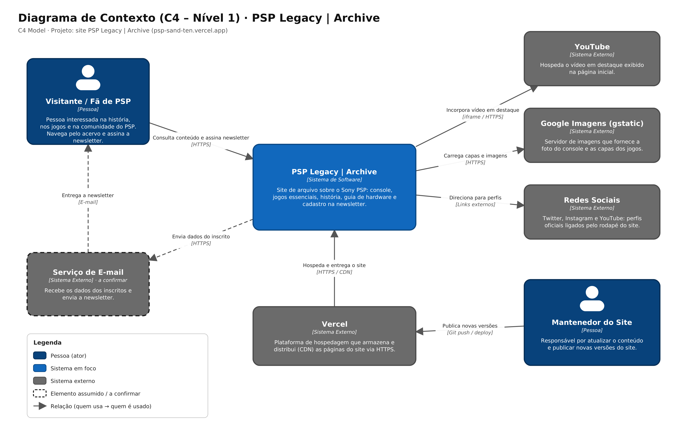
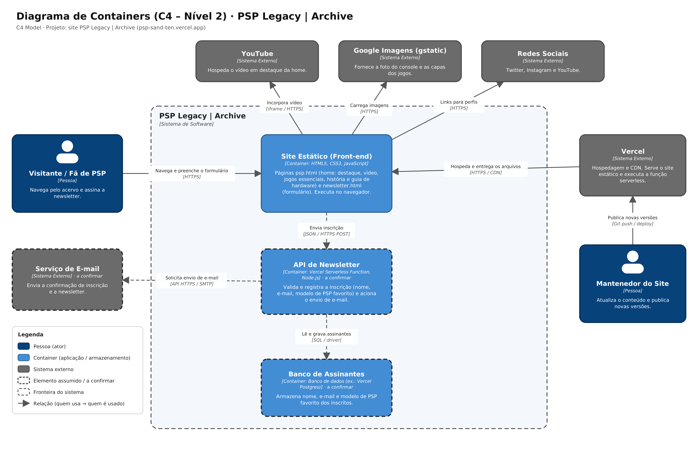

# Arquitetura

A arquitetura do PSP Legacy | Archive foi modelada com o C4 Model, usando os dois primeiros níveis:

- **Nível 1 (Contexto):** o sistema no centro, com as pessoas e os sistemas externos que se relacionam com ele.
- **Nível 2 (Containers):** o que existe dentro do sistema (aplicação, API, banco) e a tecnologia de cada parte.

!!! note "Elementos tracejados"
    O site publicado hoje é estático. Os elementos com borda tracejada nos diagramas (Serviço de E-mail,
    API de Newsletter e Banco de Assinantes) são o caminho previsto para o cadastro da newsletter, descrito na
    página de [Regras e Fluxos](regras.md).

---

## Nível 1: Diagrama de Contexto

### Pessoas (atores)

| Ator | Descrição |
|------|-----------|
| **Visitante / Fã de PSP** | Pessoa interessada na história, nos jogos e na comunidade do PSP. Navega pelo acervo e assina a newsletter. |
| **Mantenedor do Site** | Responsável por atualizar o conteúdo e publicar novas versões. |

### Sistema em foco

| Sistema | Descrição |
|---------|-----------|
| **PSP Legacy \| Archive** | Site de arquivo sobre o Sony PSP: console, jogos essenciais, história, guia de hardware e cadastro na newsletter. |

### Sistemas externos

| Sistema | Papel na solução |
|---------|------------------|
| **Vercel** | Hospeda e distribui (CDN) as páginas do site via HTTPS. |
| **YouTube** | Hospeda o vídeo em destaque exibido na página inicial. |
| **Google Imagens (gstatic)** | Fornece a foto do console e as capas dos jogos. |
| **Redes Sociais** | Twitter, Instagram e YouTube, acessados por links no rodapé. |
| **Serviço de E-mail** *(a confirmar)* | Recebe os dados dos inscritos e envia a newsletter. |

### Relacionamentos

| Origem | Destino | Descrição | Tecnologia |
|--------|---------|-----------|------------|
| Visitante | PSP Legacy | Consulta conteúdo e assina a newsletter | HTTPS |
| Mantenedor | Vercel | Publica novas versões | Git push / deploy |
| Vercel | PSP Legacy | Hospeda e entrega o site | HTTPS / CDN |
| PSP Legacy | YouTube | Incorpora o vídeo em destaque | iframe / HTTPS |
| PSP Legacy | Google Imagens | Carrega capas e imagens | HTTPS |
| PSP Legacy | Redes Sociais | Direciona para os perfis | Links externos |
| PSP Legacy | Serviço de E-mail *(a confirmar)* | Envia dados do inscrito | HTTPS |
| Serviço de E-mail *(a confirmar)* | Visitante | Entrega a newsletter | E-mail |

---

## Nível 2: Diagrama de Containers

### Containers

| Container | Tecnologia | Responsabilidade |
|-----------|------------|------------------|
| **Site Estático (Front-end)** | HTML5, CSS3, JavaScript | Páginas `psp.html` (home com destaque, vídeo, jogos essenciais, história e guia de hardware) e `newsletter.html` (formulário de inscrição). Executa no navegador do visitante. |
| **API de Newsletter** *(a confirmar)* | Vercel Serverless Function, Node.js | Valida e registra a inscrição (nome, e-mail e modelo de PSP favorito) e aciona o envio de e-mail. |
| **Banco de Assinantes** *(a confirmar)* | Banco de dados (ex.: Vercel Postgres) | Armazena nome, e-mail e modelo de PSP favorito dos inscritos. |

### Relacionamentos

| Origem | Destino | Descrição | Tecnologia |
|--------|---------|-----------|------------|
| Visitante | Site Estático | Navega e preenche o formulário | HTTPS |
| Mantenedor | Vercel | Publica novas versões | Git push / deploy |
| Vercel | Site Estático | Hospeda e entrega os arquivos | HTTPS / CDN |
| Site Estático | YouTube | Incorpora o vídeo | iframe / HTTPS |
| Site Estático | Google Imagens | Carrega imagens | HTTPS |
| Site Estático | Redes Sociais | Links para os perfis | HTTPS |
| Site Estático | API de Newsletter | Envia a inscrição | JSON / HTTPS POST |
| API de Newsletter | Banco de Assinantes | Lê e grava assinantes | SQL / driver |
| API de Newsletter | Serviço de E-mail | Solicita o envio de e-mail | API HTTPS / SMTP |

### Decisões de arquitetura

- **Site estático:** o conteúdo (jogos, história, guia de hardware) muda pouco, então não precisa de servidor de aplicação. O deploy fica simples e as páginas são entregues pela CDN.
- **Hospedagem na Vercel:** cada atualização enviada ao repositório vira uma nova versão do site, sem precisar mexer em servidor.
- **YouTube e Google Imagens:** o vídeo e as imagens vêm de serviços externos, então o projeto não guarda mídia pesada.

---

## Arquivos para download

- [Diagramas em PDF](arquivos/C4_PSP_Legacy.pdf)
- [Arquivo editável (draw.io)](arquivos/C4_PSP_Legacy.drawio)
