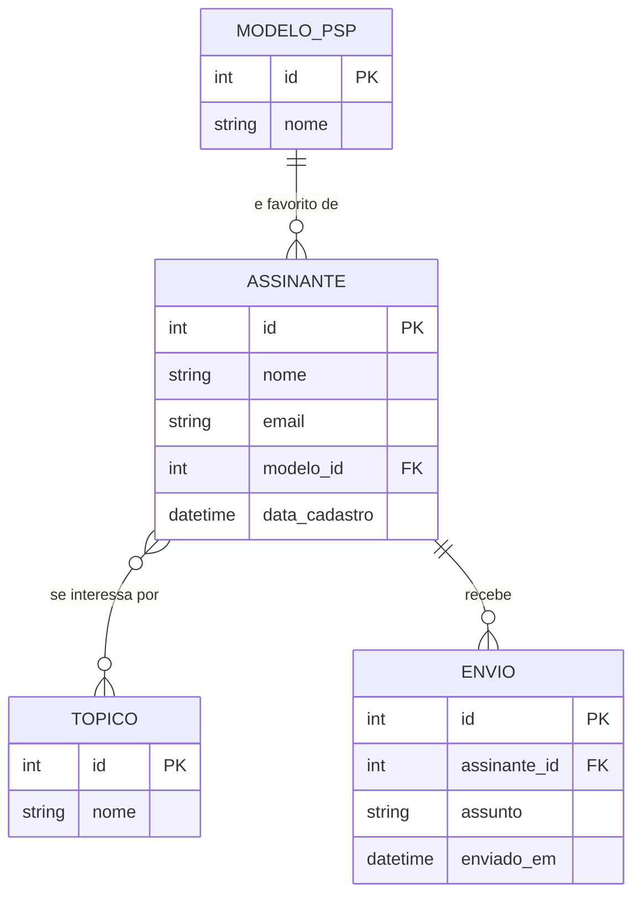
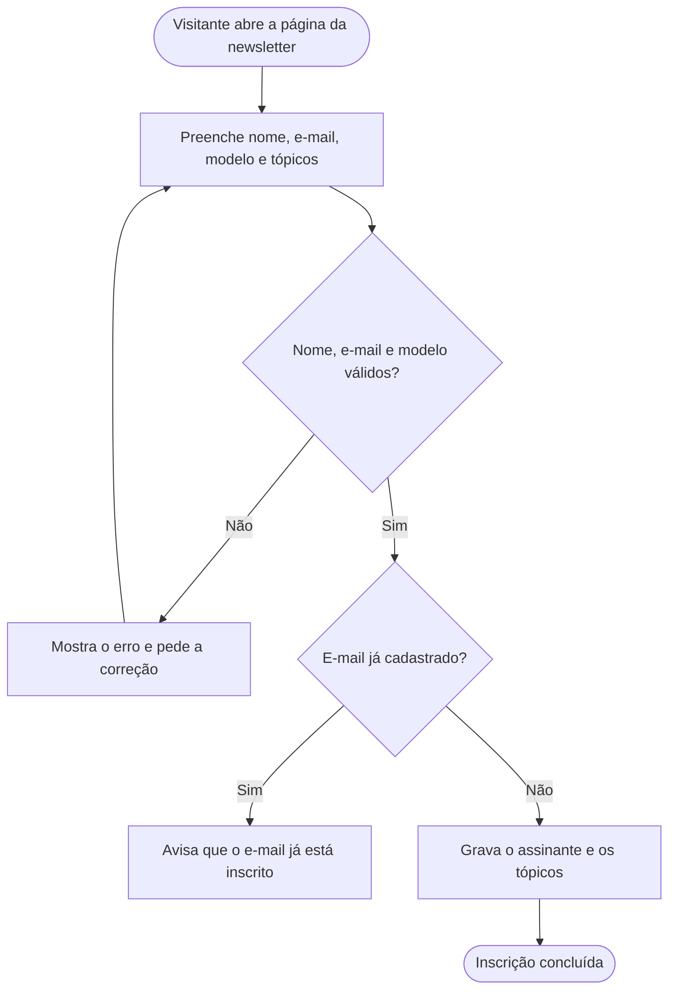

# Regras de negócio e fluxos

- **Módulo:** Cadastro de assinantes da newsletter
- **Autor:** Vinícius Gregolon
- **Status:** em desenvolvimento

## 1. Visão geral

**Contexto.** Hoje o site só mostra o formulário da newsletter (nome, e-mail e modelo de PSP favorito). Não existe nenhuma regra definida sobre o que acontece com esses dados depois do envio.

**Objetivo.** Definir como o cadastro de assinantes funciona: o que é obrigatório, o que não pode se repetir, como os dados se relacionam e o que acontece quando alguém é removido. Assim o conteúdo enviado (análises de jogos, tutoriais de hardware e novidades da comunidade) chega a quem pediu e o mantenedor consegue consultar o histórico de envios.

**Glossário**

| Termo | Significado |
|-------|-------------|
| Visitante | Pessoa que acessa o site e ainda não se inscreveu. |
| Assinante | Visitante que preencheu o formulário e está cadastrado. |
| Mantenedor | Quem cuida do site e dos dados dos assinantes. |
| Modelo de PSP | Versão do console escolhida como favorita (PSP 1000, 2000, 3000, Go ou Street). |
| Tópico | Tipo de conteúdo da newsletter: análises de jogos, tutoriais de hardware ou novidades da comunidade. |
| Envio | Registro de uma newsletter enviada a um assinante. |

## 2. Requisitos funcionais

| ID | Funcionalidade | Descrição |
|----|----------------|-----------|
| RF001 | Cadastro de assinante | Registrar um assinante com nome, e-mail e modelo de PSP favorito pelo formulário da página de newsletter. |
| RF002 | Mensagens de erro | Quando o cadastro falhar, mostrar o motivo e o que a pessoa precisa corrigir. |
| RF003 | Tópicos de interesse | Permitir que o assinante escolha um ou mais tópicos de conteúdo. |
| RF004 | Modelo favorito | Permitir escolher um modelo de PSP entre os cinco disponíveis. |
| RF005 | Registro de envios | Guardar cada newsletter enviada a um assinante, com assunto e data. |
| RF006 | Histórico de envios | Listar em ordem cronológica os envios de um assinante. |
| RF007 | Atualização de dados | Permitir a edição de nome, e-mail, modelo favorito e tópicos. |
| RF008 | Exclusão de assinante | Permitir a remoção definitiva do assinante e dos dados ligados a ele. |

## 3. Regras de negócio

- **RN001 (obrigatoriedade):** o nome é obrigatório.
- **RN002 (obrigatoriedade):** o e-mail é obrigatório e precisa ter um formato válido.
- **RN003 (obrigatoriedade):** o modelo de PSP favorito é obrigatório, e só pode ser um dos cinco: PSP 1000 (Fat), PSP 2000 (Slim), PSP 3000 (Brite), PSP Go ou PSP Street (E1000).
- **RN004 (opcionalidade):** os tópicos de interesse são opcionais. Se o assinante não escolher nenhum, recebe todos os tipos de conteúdo.
- **RN005 (unicidade):** não pode haver dois assinantes com o mesmo e-mail. Se o e-mail já estiver cadastrado, o sistema avisa e não cria outro registro.
- **RN006 (cardinalidade, modelo):** relação 1:N. Cada assinante tem um único modelo favorito, e um mesmo modelo pode ser o favorito de vários assinantes.
- **RN007 (cardinalidade, tópicos):** relação N:N. Um assinante pode ter vários tópicos, e um tópico pode ser escolhido por vários assinantes.
- **RN008 (cardinalidade, envios):** relação 1:N. Um assinante recebe vários envios, e cada envio pertence a um só assinante.
- **RN009 (exclusão em cascata):** ao excluir um assinante, todos os envios dele e os vínculos com tópicos são apagados do banco. Os modelos de PSP e os tópicos continuam existindo.

!!! warning "Atenção à RN009"
    A exclusão é física e não tem volta. O histórico de envios do assinante some junto com o cadastro.

## 4. Diagrama de entidade-relacionamento (DER)

Notação: pé de galinha (*crow's foot*). `||--o{` indica relação de um para muitos e `}o--o{` indica muitos para muitos. PK é chave primária e FK é chave estrangeira.

No banco, a relação N:N entre assinante e tópico vira uma tabela de ligação com as duas chaves estrangeiras.

## 5. Fluxo de cadastro

## 6. Critérios de aceitação

- [ ] O cadastro é bloqueado, com mensagem de erro, se nome, e-mail ou modelo estiverem vazios ou se o e-mail for inválido.
- [ ] Tentar cadastrar um e-mail que já existe mostra um aviso e não cria registro duplicado.
- [ ] O formulário permite escolher dois ou mais tópicos de uma vez.
- [ ] O histórico de envios de um assinante aparece em ordem cronológica.
- [ ] Editar um assinante atualiza os dados sem perder o histórico de envios.
- [ ] Excluir um assinante apaga os envios e os vínculos com tópicos (validar a cascata no banco).
